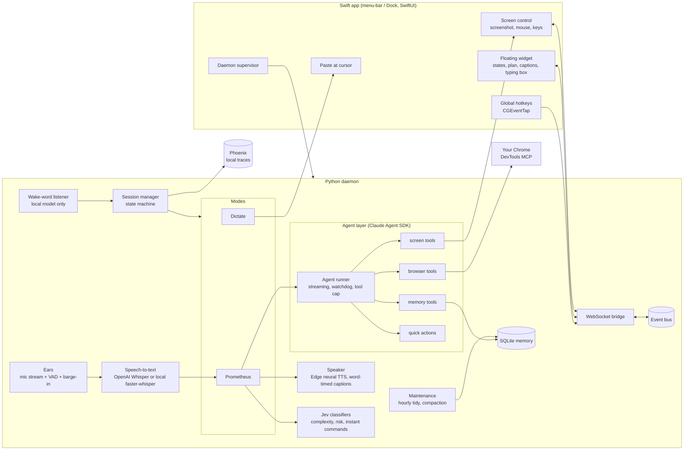
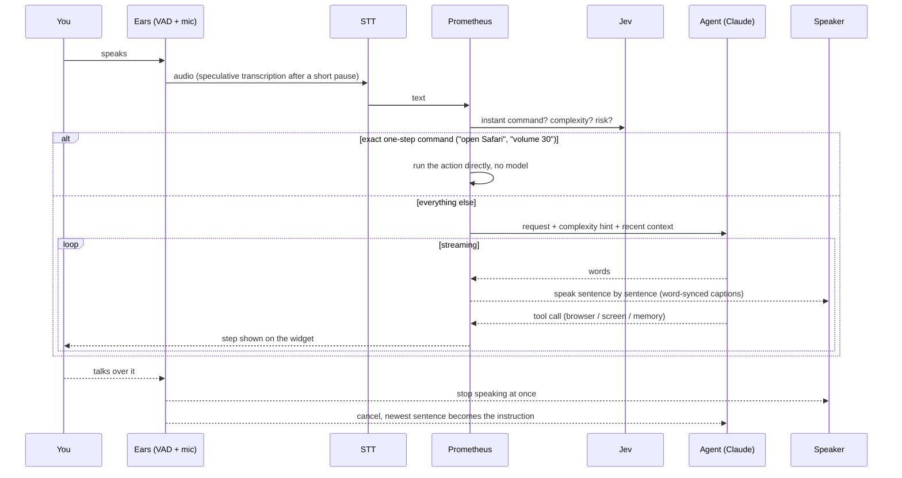
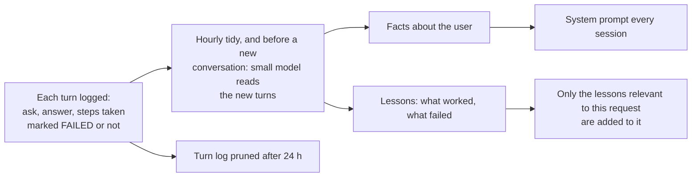
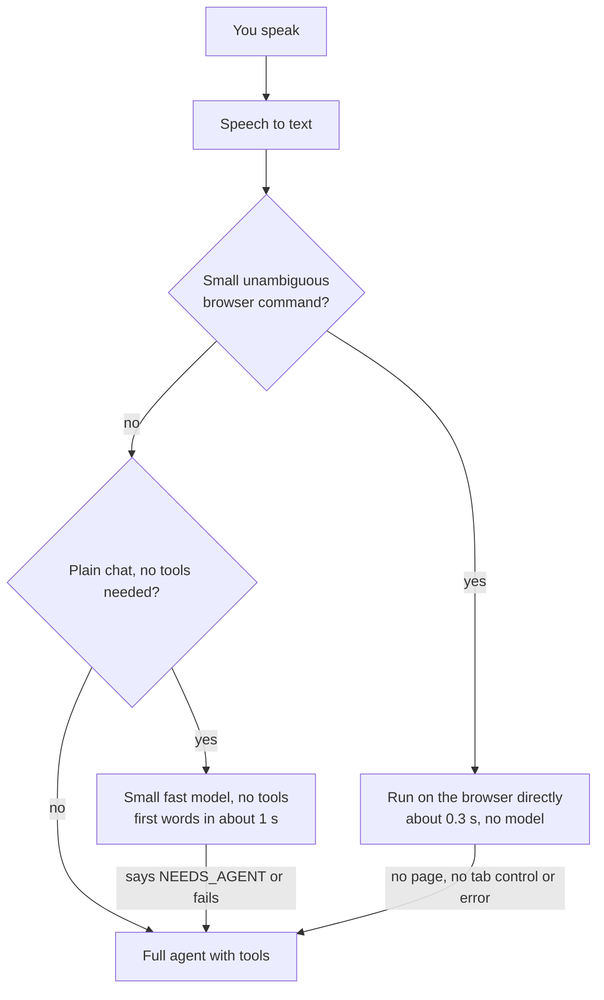
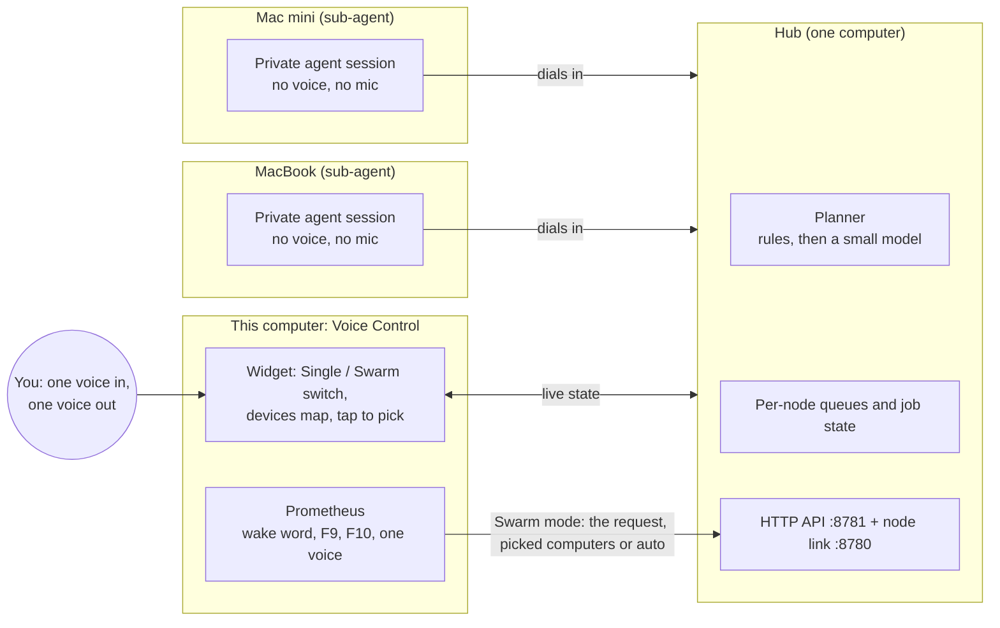

# Voice Control: design

A macOS voice assistant with two ways to talk to it:

| How | What it does |
|---|---|
| **Dictate** (hold or toggle **F9**) | Speak and the text is typed at the cursor, in any app. |
| **Prometheus** (**F10**, or say "Prometheus") | A hands-free conversation with one Claude agent that also *acts*: it drives your own logged-in Chrome, sees the screen and uses the mouse and keyboard, reads files, searches the web, and narrates what it is doing. You can talk over it, type to it, or interrupt it at any time. |

A small floating widget shows the state (listening, thinking, working, speaking), the plan for bigger tasks, and what is being said.

## Design principles

1. **One brain.** A single agent both converses and acts. No hand-off between a "chat" model and a "doer" model.
2. **Never block the human.** Full-duplex audio: it listens while it speaks, so you can cut it off. Anything slow (agent start-up, browser connection) happens in the background.
3. **Scale the ceremony to the task.** A chat reply gets no plan, a one-step action gets one sentence, a multi-step job gets a checklist.
4. **Act, don't ask.** Ordinary things (open, search, click, play) are done without permission prompts. Only a narrow gate (money, sending, deleting) asks.
5. **Everything is a plugin.** Modes, actions, skills, browser backends and TTS/STT engines are registered by name. Adding one is a new file.
6. **Local first.** The always-on wake-word listener runs on-device. Secrets live in a local `.env`, never in the repo.
7. **Observable.** Every turn is traced to a local Phoenix (Arize) instance.

## Architecture

The Swift app owns everything that needs a macOS permission (hotkeys, Accessibility, Screen Recording, pasting). The Python daemon owns audio, models and the agent. They talk over a local WebSocket carrying JSON events; the UI is a pure listener plus a few commands.

## A Prometheus turn

Key behaviours:

- **Endpointing:** a voice-activity model (Silero) decides when you are done. The pause tolerance is configurable (default 1.4 s) so you can think mid-sentence. Transcription starts speculatively after a shorter pause and is discarded if you keep talking.
- **Barge-in and echo:** on headphones the mic stays open while it speaks. On speakers an echo-aware detector (loudness-envelope matching against what it is playing) separates your voice from its own, and the system steps down (full duplex → echo-aware → deaf-while-speaking) if it keeps hearing itself.
- **Transcript hygiene:** English is forced, then transcripts that are not speech are dropped (invented subtitle phrases, other scripts, the prompt echoed back).
- **Typing:** the widget has a text box. A typed message interrupts exactly like speech.
- **Goodbyes:** any natural close ("thanks", "that's all", "good night", "I'm done") ends the conversation, but "thanks, now open Gmail" does not. The reply is a warm, varied farewell.

## The agent

One Claude agent (Sonnet) through the Claude Agent SDK, with these tool groups:

| Group | Purpose |
|---|---|
| `browser_*` | Operate the user's real Chrome: goto, read (numbered elements), click, type, scroll (verified), back/forward, media control, **tabs** (list, switch, new, close), screenshot. |
| `screen_*` | Vision and hands: screenshot of Chrome or the whole screen, click, move, drag, scroll, type, key. Clicks are marked with a ring on the next screenshot so the agent can correct its aim. |
| `memory_*` | `remember` / `forget` / `list_facts` for durable facts about the user. |
| `checklist_*` | Show and update a plan on the widget. |
| `computer_action` | Registered quick actions (open app, open folder, volume, sleep...). |
| Built-ins | Read, Glob, Grep, WebSearch, WebFetch, Skills. Anything that writes or runs commands goes through the approval gate. |

### Operating a browser like a person

The system prompt carries a playbook mapping human actions to the *most reliable* automation: switch tabs with the tab tools (not by clicking the tab strip), read and click page elements by number, use the mouse only for what elements cannot reach (video buttons, canvases, other apps), use keyboard shortcuts (cmd, not ctrl, on a Mac), and switch method after one failure instead of repeating it. Element clicks retry once on a freshly read page, then hand over to the real mouse.

### Browser backends (pluggable)

| Backend | How | Notes |
|---|---|---|
| `devtools` (default) | Chrome DevTools MCP attached to the user's own Chrome | Real clicks, logged-in sessions, no extra window. Chrome shows one *Allow* prompt per connection, so the connection is made lazily on first use and then kept. |
| `chrome` | AppleScript plus injected JavaScript | Fallback. |
| `playwright` | Separate automated Chromium | Headless / testing. |

### Keeping a turn proportionate

- **Complexity** (none / single / multi / extended) is classified in one call and passed to the agent as a hint. Only multi/extended show a checklist.
- A **single-step** request is capped at a handful of tool calls; if it keeps going, it is stopped.
- The agent is told to *do exactly what was asked, then stop*, and never repeat a status line (repeats are also filtered before speaking).
- The checklist is cleared when the turn ends.
- A **watchdog** drops a conversation that shows no sign of life within 40 s and retries once on a clean thread.

### Safety

- A **risk score** on the request plus a pattern gate (pay, send, submit, delete...) triggers a spoken/on-screen approval. Everything else runs without asking.
- Page content and tool output are treated as data, not instructions.
- The agent may not work around a browser failure by shelling out (it can open a page but not interact, which leaves half-finished work).
- Tab titles are private to the agent: never spoken or logged.

## Memory

| Kind | What | Where | Lifetime |
|---|---|---|---|
| **Working** | The live agent thread (tool results included) | Agent SDK session | One conversation; compacted automatically after ~20 turns |
| **Episodic** | What was asked and answered (never tool output) | SQLite `turns` | 24 h; the last exchanges are recapped into a fresh session |
| **Summary** | A short digest of older exchanges | a protected fact | Rewritten on each tidy or compaction |
| **Semantic** | Durable facts about the user (roles, target companies, preferences, resume summary) | SQLite `facts` | Long-term. Saved by the agent when told, and extracted automatically from conversations |
| **Procedural / learnings** | Lessons about *how to do things well*: site quirks, a method that worked after another failed, corrections from the user | Its **own store**, `learnings.db` | Long-term. Strengthened when seen again, ranked by use and recency, capped at 300 (your own are never culled). Survives "start fresh"; erased only by "forget what you've learned" |
| **Static playbooks** | Hand-written prompt playbook and `SKILL.md` skills | Prompt, `.claude/skills` | Fixed |

### How long-term memory is built

- **Learns from outcomes, not transcripts.** The extractor sees the steps that failed and what finally worked, so a lesson such as "open the search URL, don't click the filter" comes from experience. A misheard sentence cannot become a "fact" by itself.
- **Extract before delete.** Facts and lessons are written before old turns are pruned or a conversation is cleared, so what mattered outlives the conversation that produced it.
- **Relevant, not everything.** Each request carries only the few lessons that match it (by site, tool and keywords), so memory grows without bloating the prompt.
- **Every action is recorded.** Each browser or mouse action is logged with its site and whether it worked. A pattern that keeps failing on a site, one that keeps working (going straight to a URL), or a failure followed by a different method that worked becomes a lesson automatically, with no model call. Lessons are scoped to the site and task they came from, so what was learned on LinkedIn is not applied to other sites.
- **Separate store.** Learnings are knowledge about the web and the tools, not about you, so they live in their own database, apart from conversation memory.
- **Inspectable.** Ask "what have you learned?" (the agent lists them) or "forget that lesson".

Lifecycle controls:

- **Restart or idle timeout** starts a clean agent thread plus a compact recap (resuming a huge old thread is slow and costly).
- **Hourly tidy** (only when idle): condense old sessions, prune stale turns and facts, collect garbage, restart the process if it has grown.
- **New conversation** (widget button, Dock menu, or "new conversation" / "you're stuck"): clean context; facts and lessons are kept (anything new is learned first).
- **Start fresh** (two-click button, or "forget everything"): wipes all memory.

## Speech

- **Dictation and conversation STT:** OpenAI Whisper API by default (best accuracy on names and accents), or local faster-whisper (offline, free). Swappable by config.
- **Wake word:** always local (small faster-whisper model); room audio never leaves the machine. Matching is by spelling *and* sound, across split words ("pro me the us"), only near the start of an utterance.
- **TTS:** Edge neural voices, streamed sentence by sentence with a short pre-roll to wake Bluetooth outputs, cached on disk; captions are revealed in step with the audio. A toggle switches to text-only replies (handy on speakers).
- **Microphone resilience:** if the default input changes (AirPods off, USB mic in) the stream is re-opened, the audio system is refreshed, and a device that refuses 16 kHz is recorded at its native rate and converted.

## The widget

States are colour-coded with Siri-style ribbons: idle, listening, transcribing, thinking, working, speaking, approval, music. Controls: voice on/off, type to Prometheus, new conversation, start fresh (two clicks). Long captions grow, then scroll. It is draggable, never steals focus (it only takes the keyboard while its text box is open), and uses a near-solid dark card so it reads on light and dark backgrounds.

## Music mode

While media plays, the assistant keeps listening but acts only on utterances that start with its name, so lyrics and the video's own audio are ignored.

## Profiles and releases

- **dev** (default when running from source): separate data folder, port and config overlay; no hotkeys, wake word, or TTS by default. This keeps automated testing away from the user's real setup.
- **stable** (the installed app): runs from an immutable **release snapshot** with its own virtualenv. `scripts/release.sh` builds a snapshot, verifies it boots as `stable`, rebuilds the app pointed at it, and refuses to run while the app is open. Releases are timestamped, so rolling back is re-pointing one link.
- The app is a single `Voice Control.app` (Dock-pinnable) that supervises the daemon, restarts it if it dies, and keeps the previous run's log for debugging.

## Privacy and security

- **Leaves the machine:** speech audio and text to the STT/LLM/TTS providers you configure, and agent traffic to Anthropic. The wake-word audio does not.
- **Secrets:** API keys live in a git-ignored `.env` (user-level, outside the repo for installed releases). Names used: `ANTHROPIC_API_KEY`, `OPENAI_API_KEY` (Whisper), `TYPESAFE_API_KEY` (Jev), `TAVILY_API_KEY` and `OPENWEATHERMAP_API_KEY` (optional skills).
- **Local data:** memory database, voice cache, traces and logs stay under the app's data folder and are git-ignored.
- **Permissions requested:** Microphone, Accessibility and Input Monitoring (hotkeys, mouse/keyboard control, paste), Screen Recording (screenshots).

## Speed: three ways a request is answered

- **Instant path** (`modes/instant.py`): whole-utterance patterns only ("scroll down", "go back", "pause", "new tab", "switch to my LinkedIn tab", "search YouTube for ..."). Any mismatch or error hands the request to the agent.
- **Quick chat**: only for requests classified as plain conversation, never for anything that mentions the browser, files or an action word. The small model may answer with a single hand-off word; nothing has been spoken yet, so the agent then answers cleanly. What it said is recorded for the agent and for memory.
- **Every turn is timed.** One log line per turn, and a waterfall in Phoenix (speech to text, routing, agent start, model first token, every tool call, first sound). Each conversation has a **session id** that is its start time in epoch seconds, so all of its traces group under one session in Phoenix and map to a clock time.

## Failure modes: designing against brittleness

Every optimisation has a slower, safer path behind it, and a switch to turn it off.

| If this fails or is missing | What happens | Switch |
|---|---|---|
| Instant command doesn't match, no page open, tab control missing, any error | The agent handles the request | `agent.instant_browser` |
| Quick-chat model unavailable or says it needs tools | The agent answers | `agent.fast_chat` |
| Agent gives no sign of life for 40 s | Its thread is dropped and the request retried once on a clean one | `agent.first_response_timeout_s` |
| A one-step request keeps calling tools | It is stopped (6 calls; 40 for longer jobs) | `agent.single_step_tool_cap` |
| An element click fails | Retried on a freshly read page, then the real mouse is suggested | |
| Default microphone changes or goes stale | The stream is reopened, the audio system refreshed, a device that refuses 16 kHz is converted | |
| The app restarts | A clean agent thread plus a compact recap, never the full old thread | `agent.resume_after_restart` |
| Tracing, timing or telemetry fails | Swallowed: a turn never fails because of observability | `telemetry.enabled` |
| Chrome DevTools connection unavailable | Falls back to the AppleScript, then Playwright backends | `browser.backend` |
| Speech-to-text API unreachable or out of credit | Switch to the local engine with one setting | `stt.backend` |
| Memory extraction (Anthropic) unavailable | Skipped and retried next hour | |
| The swarm hub is unreachable from the voice assistant | The tools say so, and the assistant offers to do it on this computer | `swarm.enabled` |

Standing rule for changes to this project: check the architecture each time and keep it from becoming brittle. Before shipping, ask what happens if a dependency is missing, whether there is a safe fallback and an off switch, and whether the failure path has a test.

## Prometheus Swarm

The same app on several of your computers, connected. Every computer runs its own Prometheus and works on its own; the swarm is a layer that lets one of them send a request to all of them.

- **Single / Swarm switch.** In Single, Prometheus works exactly as always. In Swarm, the transcribed request (spoken or typed) skips this computer's agent and goes **straight to the hub**, which assigns it to the computers' agents. There is one microphone and one voice: the answer is spoken **once**, at the end, with the full text on screen.
- **Auto or manual.** With nothing picked the planner decides (a named computer or "both" needs no model; otherwise a small model, with a safe fallback); tapping computers on the widget's map sends the request only to those (several = the same task to each, in parallel). A picked computer that goes offline is dropped, and a request to one that is gone fails clearly.
- **Every computer is a sub-agent.** A node dials the hub (so a laptop works wherever it is, a sleeping Mac shows as offline, and a restarted hub is rejoined with backoff) and runs each task in its **own private agent session** (own memory and event bus, sharing the Mac's browser connection and screen control). It has no voice and no microphone, so it never talks over you, and the Prometheus you use on that Mac is unaffected. One task per node at a time; more queue.
- **Results.** Each computer's progress and result appear on the map as it finishes; several results are woven into one short answer by a small model (plain join as the fallback). Approvals for risky steps (money, sending, deleting) appear on the widget, so you can answer from a phone too.
- **The API is the single surface** (`GET /api/computers`, `POST /api/jobs {text, computer?, computers?}`, `GET /api/jobs/{id}` and `.../wait?after=N`, `POST .../cancel`, `POST /api/subs/{id}/approve`, `GET /api/events` as server-sent events; a bearer token on everything but `/api/health`). The widget's link, the voice assistant's `swarm_*` tools, a phone and a Shortcut all use it; it holds no state of its own.
- **The assistant's swarm tools.** Even in Single mode, if you say "on the mini, ...", the agent can call `swarm_run` / `swarm_wait` (results reported as each computer finishes). An agent that is itself running a swarm task gets none of these tools, so work can never bounce between computers.
- **Headless computers.** A computer you never open the app on can run `scripts/swarm_node.sh install`, a login launch agent running the same node with no window. A pid file (`swarm_backend.pid`) lets only one process per computer run the swarm.
- **Security in this version:** one shared token on every connection, on a home network, no internet exposure. Per-device keys and per-node permissions are the planned next step.
- **Failure behaviour.** If the hub is unreachable the request is handled on this computer, with a notice; interrupting (talking over it, Esc) cancels the work on the other computers too; a node that disappears fails its task with a clear message and shows greyed out; a task over 20 minutes is cut off; a node error never takes the node down.
- **Known limits.** A swarm task and local use of the same Mac share one browser tab, so avoid driving it locally while a swarm task runs there; the hub is a single point of failure (nodes keep retrying, and any computer can be made the hub by config); a phone is a controller only, since iOS cannot be automated like a Mac.

## Observability

OpenTelemetry spans around each mode and turn go to a local Phoenix instance (`uv tool run ... phoenix serve`). Per-turn latency (speech end → text → first audio) and cost are logged and shown.

## Extending

| To add | Do this |
|---|---|
| A mode | New file in `modes/` with `@modes.register("name")` |
| A quick action | New file in `actions/` with `@actions.register(...)` |
| A skill | New folder in `.claude/skills/<name>/SKILL.md` |
| A browser backend | Implement the backend protocol and register it |
| An STT or TTS engine | Implement the base class, register by name, select in `config.yaml` |
| Agent tools | Add an in-process MCP tool and list it in the allowed tools |

## Known limits and next steps

- Learned lessons are text hints, not verified procedures; a lesson that stops working is only demoted by disuse (or by being told to forget it).
- Chrome requires one *Allow* click per app launch for the DevTools connection (a Chrome design choice).
- On open speakers, hearing itself is mitigated, not eliminated; headphones are the clean setup.
- Screenshot-based clicking depends on the model's aim; the ring marker and DOM-first strategy reduce, not remove, misses.
