# Voice Control: design

A macOS voice assistant with two ways to talk to it:

| How | What it does |
|---|---|
| **Dictate** (hold or toggle **F9**) | Speak and the text is typed at the cursor, in any app. |
| **Prometheus** (**F10**: press to record, press again to send) | A push-to-talk conversation with one Claude agent that also *acts*: it drives your own logged-in Chrome, sees the screen and uses the mouse and keyboard, reads files, searches the web, and narrates what it is doing. You can talk over it, type to it, or interrupt it at any time. |

A small floating widget shows the state (listening, thinking, working, speaking), the plan for bigger tasks, and what is being said.

## Design principles

1. **One brain.** A single agent both converses and acts. No hand-off between a "chat" model and a "doer" model.
2. **Never block the human.** Pressing F10 (or typing and pressing Enter) cuts off whatever it is saying or doing and starts your next request. Anything slow (agent start-up, browser connection) happens in the background.
3. **Scale the ceremony to the task.** A chat reply gets no plan, a one-step action gets one sentence, a multi-step job gets a checklist.
4. **Act, don't ask.** Ordinary things (open, search, click, play) are done without permission prompts. Only a narrow gate (money, sending, deleting) asks.
5. **Everything is a plugin.** Modes, actions, skills, browser backends and TTS/STT engines are registered by name. Adding one is a new file.
6. **Nothing listens unless you ask.** The microphone is open only while you record: no wake word, no always-on listener. Secrets live in a local `.env`, never in the repo.
7. **Observable.** Every turn is traced to a local Phoenix (Arize) instance.

## Architecture

The app is a **widget** (Swift) and a **daemon** (Python) that talk only through two typed contracts. Inside the daemon,
everything that touches the outside world sits behind a small interface, and the two ways a request arrives (voice and
typing) are separate channels that feed one core. The rule: **the core never asks where a request came from, which
provider answered, or which OS did the work.**

### The layers

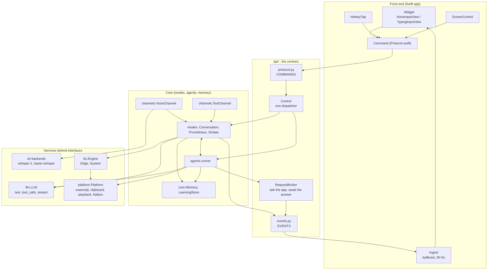

### The main app

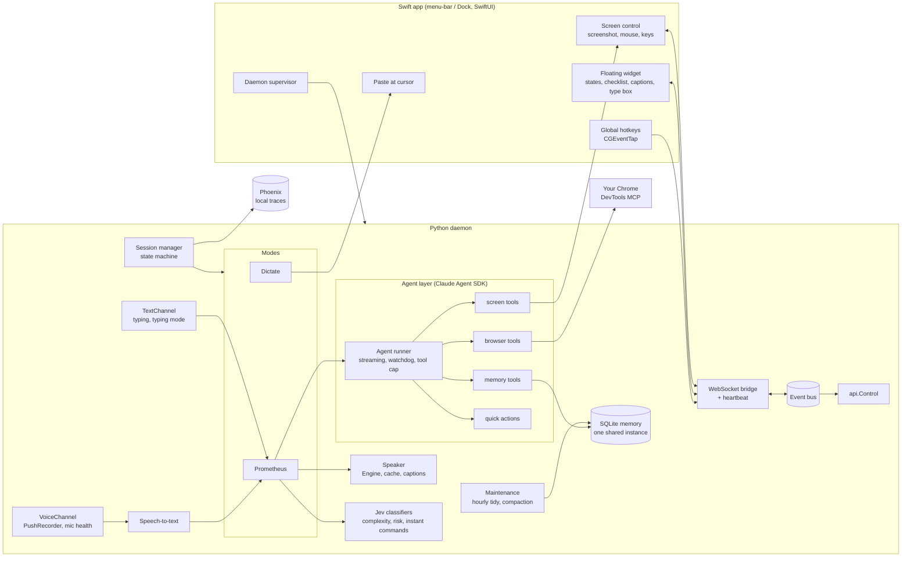

The Swift app owns everything that needs a macOS permission (hotkeys, Accessibility, Screen Recording, pasting). The
Python daemon owns audio, models and the agent. They talk over a local WebSocket carrying JSON: **commands** one way,
**events** the other.

## The APIs

### Front end to daemon: commands

One table, `voicectl/api/protocol.py`. Every message is validated before anything runs; an unknown or malformed one is
logged and dropped. `api.Control` is the single dispatcher: handlers are registered per command, a slow command never holds
up a different one, the same command keeps its order, and a failing handler is logged without stopping the others. The
widget builds commands only through `Command` in `Protocol.swift`, and a test fails if the two lists ever differ.
(`?` marks an optional field.)

| Command | Fields | What it does |
|---|---|---|
| `text` | `text` | A typed message. Interrupts what it is saying or doing and becomes the newest instruction. |
| `input_mode` | `mode` | `typed` when the type box opens (F10 is ignored and the mic is never opened), `voice` when it closes. |
| `voice` | `on` | Speak replies aloud, or show them as text only. |
| `newchat` | none | Clean conversation; facts and lessons are kept. |
| `fresh` | none | Forget everything. |
| `maintenance` | none | Tidy memory now. |
| `key` | `name`, `down` | A hotkey seen by the app (F9 / F10 / Esc). The app owns the macOS permissions. |
| `approval` | `approved` | The answer to an approval question (Approve / Deny buttons). |
| `input_result` | `id` | The app's answer to an `input_request`: a screenshot, or a click / key press done. |

### Daemon to front end: events

One table, `voicectl/api/events.py`. Every event any test publishes is checked against it, and so is every event the
widget handles. (`?` marks an optional field, which may also be empty.)

| Event | Fields | What it means |
|---|---|---|
| `config` | `hotkeys`, `cancel` | Sent once on connect: hotkeys and the cancel key. |
| `heartbeat` | none | Every 3 s. If it stops, the widget says NOT RESPONDING and keeps animating. |
| `state` | `state`, `mode`? | Where the conversation is: idle, listening, transcribing, thinking, acting... |
| `level` | `value` | Microphone loudness 0..1 (the widget keeps only the latest value). |
| `transcript` | `text`, `mode`? | What you said or typed. |
| `notice` | `text` | A short heads-up under the pill. |
| `error` | `message` | Something failed, in plain words. |
| `plan` | `steps` | The steps of a bigger task (before it starts). |
| `step` | `text`, `done`?, `failed`? | One thing the agent is doing or has done (done / failed). |
| `checklist` | `items`, `summary`?, `level`? | The progress report: items with pending / in_progress / done / skipped. |
| `result` | `text` | The reply text. Hidden when it only restates the checklist. |
| `speech_text` | `text` | The words of a reply as they are spoken (live captions). |
| `approval` | `text` | The agent is asking permission (money, sending, deleting). |
| `job` | `active`, `text`? | A task is running in the background while you keep talking. |
| `voice` | `on` | Whether replies are spoken (also sent to a new widget on connect). |
| `speaking` | `on` | The assistant is talking. |
| `music` | `on`, `title`? | A song or video is playing: the widget shows its title (F10 records over it as usual). |
| `route` | `kind`, `how`?, `confidence`?, `action`? | How the request was classified: chat, action or agent. |
| `session` | `label` | The agent session label (turn count, minutes); empty after a new conversation. |
| `cost` | `usd`, `turns` | Cost in dollars and the number of agent turns of the last run. |
| `input_request` | `id`, `op` | The agent asks the app to look at or act on the screen. |
| `paste` | `text` | Dictation text for the app to paste at the cursor. |

### Python interfaces

Each is a small `Protocol`. Call sites say *what* they want; only the implementation knows *how*. Swap one object (or use a
fake in a test) and nothing else changes. A guard test per row fails if code reaches around the interface.

| Interface | Where | Operations | Implementations | Guard |
|---|---|---|---|---|
| `Control` | `api/control.py` | `on(name, handler)`, `start()`, `stop()` | the daemon's one dispatcher | tests for validation, isolation, ordering |
| `RequestBroker` | `api/requests.py` | `request(event, timeout, **args)`, `resolve(command)` | request/response over events (screen, mouse, keys) | timeout and id-matching tests |
| `VoiceChannel` | `channels/voice.py` | `open`, `press`, `pause`, `recording`, `on_mic_problem` | `PushRecorder`: press to start, press to send; the mic is open only while recording | stands-alone tests |
| `TextChannel` | `channels/text.py` | `exclusive`, `note_typed`, `recently_used` | typing and the exclusive typing mode | |
| `LLM` | `llm/__init__.py` | `text`, `tool_calls`, `stream` | `AnthropicLLM` | the SDK is imported only in `llm/` |
| `Engine` (TTS) | `tts/engines.py` | `synth(text, path)`, `ext`, `cacheable` | `EdgeEngine`, `SystemEngine` | the Edge library is imported only there |
| STT backend | `stt/base.py` | `transcribe(audio, sr, hint)`, `warm_up` | `openai_api` (whisper-1), `faster_whisper` | registered by name |
| `Platform` | `platform/__init__.py` | `run`, `osascript`, `osascript_async`, `clipboard_read/write`, `audio_devices_json`, `process_rss_kb`, `find_folders`, `open_application`, `to_wav16k`, `start_playback`, `say_to_file` | `MacOS` | no other module may call `subprocess` |
| `Memory`, `LearningStore` | `core/memory.py`, `core/learnings.py` | facts, turns, sessions, `newest_turn_id`, `clear_turns`, learnings | SQLite, one shared `Memory` | only these two files touch the database |
| Registries | `modes/`, `actions/`, `stt/` | `@modes.register`, `@actions.register`, `backends.get` | each mode, action and backend | |

### Swift side

| Piece | File | Job |
|---|---|---|
| `Command` / `CommandName` | `Protocol.swift` | The only place the widget builds a message for the daemon |
| `Ingest` | `Socket.swift` | Takes every daemon message off the main thread, collapses the mic level to its latest value, and hands a batch to the UI 30 times a second. Also measures silence for the stall report |
| `OverlayModel` | `Model.swift` | The widget's state; `usesMic` says whether anything microphone-related may show |
| `VoiceInputView`, `TypingInputView` | `InputViews.swift` | The two input kinds. The typing view has no waveform, timer, voice toggle or hints |
| `ScreenControl` | `ScreenControl.swift` | Screenshots, mouse and keys, always on a background queue |
| `HotkeyTap` | `HotkeyTap.swift` | F9 / F10 / Esc, sent as `key` commands |

## Pathways

Every diagram below is one pathway through the code.

### Voice input (push-to-talk)

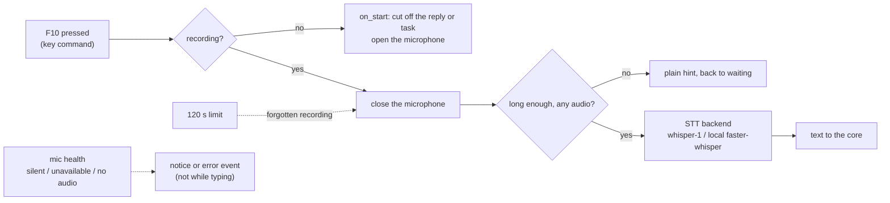

The microphone is open only between the two presses, so there is no always-on listener, no wake word and no echo to
cancel. Starting a recording is also the interruption: it stops speech and cancels the running reply (an approval
question waiting for your answer is kept). Owns it: `channels/voice.py`, `input/mic.py`, `stt/`.

### Typing

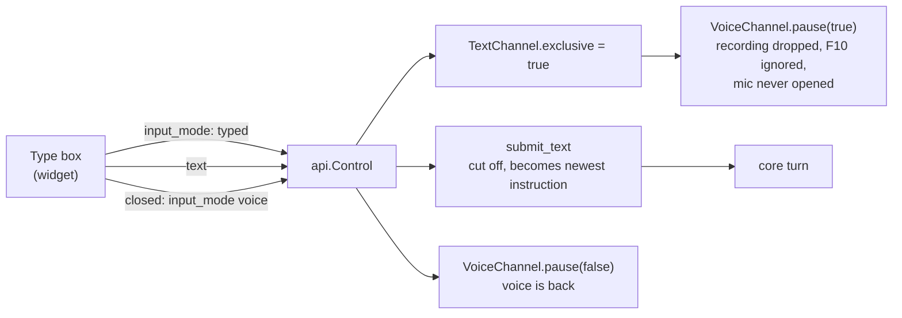

While the box is open the widget shows the typing view: no waveform, no listening timer, no voice toggle, no hints, and
the pill reads WORKING or READY. A silent microphone is never reported while you type.

### Commands (widget to daemon)

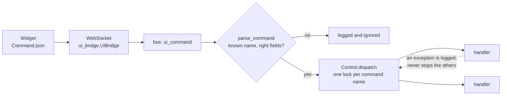

### Events (daemon to widget) and the stall report

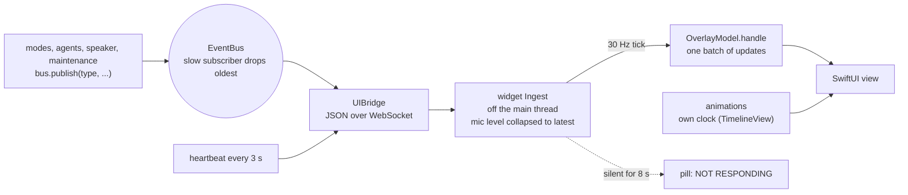

The widget's animation never waits on the daemon: the daemon only changes what is shown. A flood of messages becomes at
most 30 small updates a second; silence changes nothing except the stall label.

### Screen and mouse

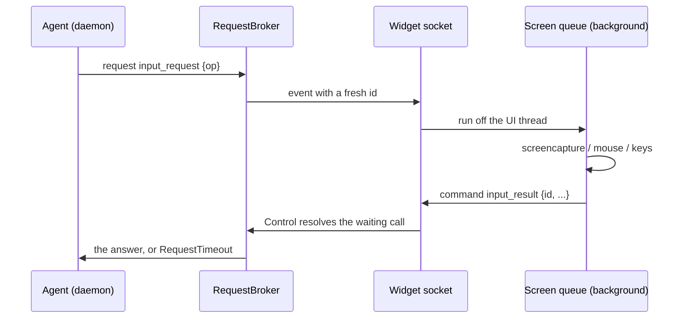

### Dictation (F9)

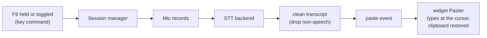

### Approvals

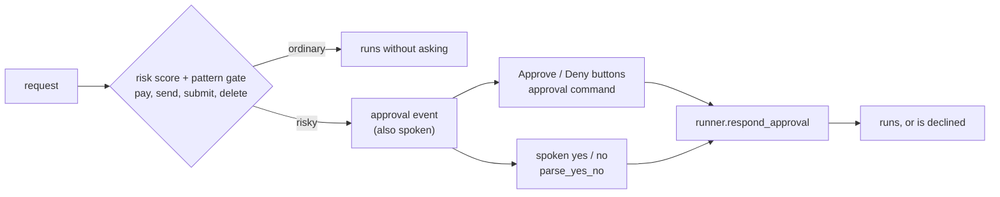

### Music mode

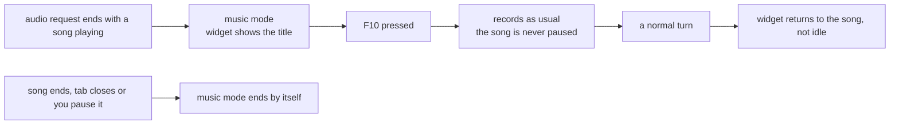

### Releases and profiles

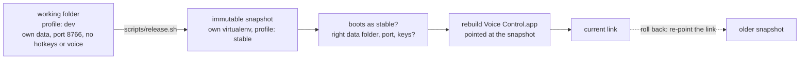

## A Prometheus turn

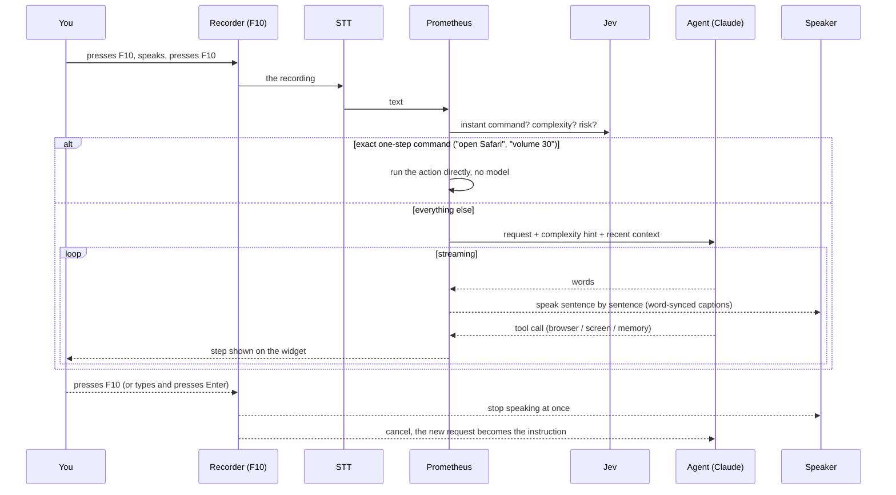

Key behaviours:

- **Push-to-talk:** F10 starts a recording and F10 again sends it, like dictation on F9. Nothing is heard in between, so there is no echo, no talking over it and no endpoint guessing. A recording that is too short is ignored with a hint; a forgotten one ends itself after 120 s.
- **Interrupting:** starting a recording, or typing a message and pressing Enter, cuts off whatever it is saying or doing. A running background task is not stopped by the key: you can give instructions while it works, and say "stop" to cancel it.
- **Transcript hygiene:** English is forced, then transcripts that are not speech are dropped (invented subtitle phrases, other scripts, the prompt echoed back).
- **Typing:** the widget has a text box. While it is open the microphone is never used. A typed message interrupts exactly like a new recording.
- **Goodbyes:** any natural close ("thanks", "that's all", "good night", "I'm done") ends the conversation, but "thanks, now open Gmail" does not. The reply is a warm, varied farewell. Otherwise the conversation stays open until you press Esc.
- **Shrinking:** thirty seconds after the last F10 press, with nothing running, the card collapses back to the small pill. It never shrinks while a reply is being spoken, a task runs, an approval waits or you are recording.

## The agent

One Claude agent (Sonnet) through the Claude Agent SDK, with these tool groups:

| Group | Purpose |
|---|---|
| `browser_*` | Operate the user's real Chrome: goto, read (numbered elements), click, type, scroll (verified), back/forward, media control, **tabs** (list, switch, new, close), screenshot. |
| `screen_*` | Vision and hands: screenshot of Chrome or the whole screen, click, move, drag, scroll, type, key. Clicks are marked with a ring on the next screenshot so the agent can correct its aim. |
| `memory_*` | `remember` / `forget` / `list_facts` for durable facts about the user. |
| `checklist_*` | Show and update a plan on the widget. |
| `computer_action` | Registered quick actions (open app, open folder, volume, sleep...). |
| Built-ins | Read, Glob, Grep, WebSearch, WebFetch, Skills. Anything that writes or runs commands goes through the approval gate. |

### Operating a browser like a person

The system prompt carries a playbook mapping human actions to the *most reliable* automation: switch tabs with the tab tools (not by clicking the tab strip), read and click page elements by number, use the mouse only for what elements cannot reach (video buttons, canvases, other apps), use keyboard shortcuts (cmd, not ctrl, on a Mac), and switch method after one failure instead of repeating it. Element clicks retry once on a freshly read page, then hand over to the real mouse.

### Browser backends (pluggable)

| Backend | How | Notes |
|---|---|---|
| `devtools` (default) | Chrome DevTools MCP attached to the user's own Chrome | Real clicks, logged-in sessions, no extra window. Chrome shows one *Allow* prompt per connection, so the connection is made lazily on first use and then kept. |
| `chrome` | AppleScript plus injected JavaScript | Fallback. |
| `playwright` | Separate automated Chromium | Headless / testing. |

### Keeping a turn proportionate

- **Complexity** (none / single / multi / extended) is classified in one call and passed to the agent as a hint. Only multi/extended show a checklist.
- A **single-step** request is capped at a handful of tool calls; if it keeps going, it is stopped.
- The agent is told to *do exactly what was asked, then stop*, and never repeat a status line (repeats are also filtered before speaking).
- The checklist is cleared when the turn ends.
- A **watchdog** drops a conversation that shows no sign of life within 40 s and retries once on a clean thread.

### Safety

- A **risk score** on the request plus a pattern gate (pay, send, submit, delete...) triggers a spoken/on-screen approval. Everything else runs without asking.
- Page content and tool output are treated as data, not instructions.
- The agent may not work around a browser failure by shelling out (it can open a page but not interact, which leaves half-finished work).
- Tab titles are private to the agent: never spoken or logged.

## Memory

| Kind | What | Where | Lifetime |
|---|---|---|---|
| **Working** | The live agent thread (tool results included) | Agent SDK session | One conversation; compacted automatically after ~20 turns |
| **Episodic** | What was asked and answered (never tool output) | SQLite `turns` | 24 h; the last exchanges are recapped into a fresh session |
| **Summary** | A short digest of older exchanges | a protected fact | Rewritten on each tidy or compaction |
| **Semantic** | Durable facts about the user (roles, target companies, preferences, resume summary) | SQLite `facts` | Long-term. Saved by the agent when told, and extracted automatically from conversations |
| **Procedural / learnings** | Lessons about *how to do things well*: site quirks, a method that worked after another failed, corrections from the user. Also **routes**: a whole task that hit failures and still got there (its goal, what failed, the route that worked) | Its **own store**, `learnings.db` | Long-term. Strengthened when seen again, ranked by use and recency, capped at 300 lessons and 100 routes (your own lessons are never culled). Survives "start fresh"; erased only by "forget what you've learned" |
| **Dead ends (this conversation)** | What failed earlier in this conversation and has not worked since | In memory, in the agent | Until a new conversation; carried into every next turn, even after the thread is compacted or restarted |
| **Static playbooks** | Hand-written prompt playbook and `SKILL.md` skills | Prompt, `.claude/skills` | Fixed |

### Routes: reusing the way that worked

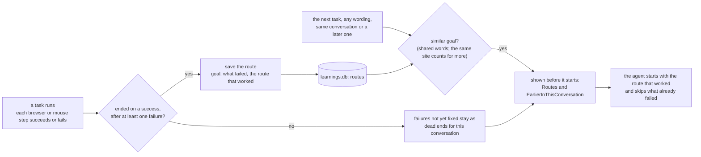

- **Saved the moment the task ends**, so the very next turn of the same conversation already benefits; routes also survive restarts.
- **Matched by the goal, not only the site**, so a differently worded task, or one that starts before any page is open, still finds it. At most two routes (about 300 characters each) are shown, so it costs few tokens.
- **The same task again strengthens the route** and keeps the shortest way that worked. A route that stops working is just a hint: the agent says so and tries another way.
- **Single mode and every swarm worker share it**, because they run the same agent. Each keeps its own `learnings.db`.
- **Inspectable:** "what have you learned?" lists routes with the lessons, and "forget ..." removes them.

### How long-term memory is built

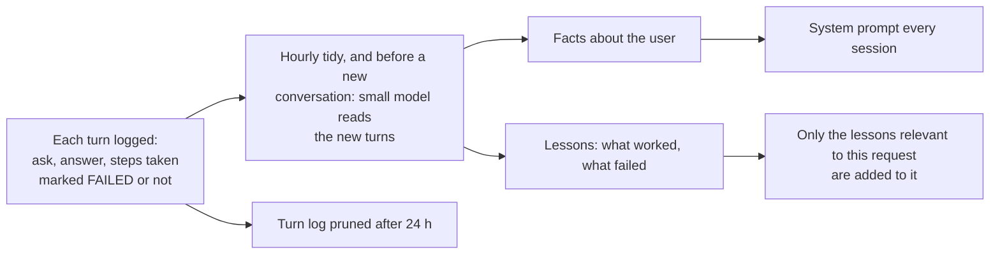

- **Learns from outcomes, not transcripts.** The extractor sees the steps that failed and what finally worked, so a lesson such as "open the search URL, don't click the filter" comes from experience. A misheard sentence cannot become a "fact" by itself.
- **Extract before delete.** Facts and lessons are written before old turns are pruned or a conversation is cleared, so what mattered outlives the conversation that produced it.
- **Relevant, not everything.** Each request carries only the few lessons that match it (by site, tool and keywords), so memory grows without bloating the prompt.
- **Every action is recorded.** Each browser or mouse action is logged with its site and whether it worked. A pattern that keeps failing on a site, one that keeps working (going straight to a URL), or a failure followed by a different method that worked becomes a lesson automatically, with no model call. Lessons are scoped to the site and task they came from, so what was learned on LinkedIn is not applied to other sites.
- **Separate store.** Learnings are knowledge about the web and the tools, not about you, so they live in their own database, apart from conversation memory.
- **Inspectable.** Ask "what have you learned?" (the agent lists them) or "forget that lesson".

Lifecycle controls:

- **Restart or idle timeout** starts a clean agent thread plus a compact recap (resuming a huge old thread is slow and costly).
- **Hourly tidy** (only when idle): condense old sessions, prune stale turns and facts, collect garbage, restart the process if it has grown.
- **New conversation** (widget button, Dock menu, or "new conversation" / "you're stuck"): clean context; facts and lessons are kept (anything new is learned first).
- **Start fresh** (two-click button, or "forget everything"): wipes all memory.

## Speech

- **Dictation and conversation STT:** OpenAI Whisper API by default (best accuracy on names and accents), or local faster-whisper (offline, free). Swappable by config.
- **TTS:** Edge neural voices, streamed sentence by sentence with a short pre-roll to wake Bluetooth outputs, cached on disk; captions are revealed in step with the audio. A toggle switches to text-only replies (handy on speakers).
- **Microphone resilience:** each recording opens the default input fresh. If the device list is stale (AirPods off, USB mic in) the audio system is refreshed and the open retried, and a device that refuses 16 kHz is recorded at its native rate and converted.

## The widget

States are colour-coded with Siri-style ribbons: idle, listening, transcribing, thinking, working, speaking, approval, music. Controls: voice on/off, type to Prometheus, new conversation, start fresh (two clicks). Long captions grow, then scroll. It is draggable, never steals focus (it only takes the keyboard while its text box is open), and uses a near-solid dark card so it reads on light and dark backgrounds.

## Music mode

While media plays the widget shows the song and stays on it between requests. Press F10 to talk over it as usual; the song is never paused by the assistant.

## Profiles and releases

- **dev** (default when running from source): separate data folder, port and config overlay; no hotkeys or TTS by default. This keeps automated testing away from the user's real setup.
- **stable** (the installed app): runs from an immutable **release snapshot** with its own virtualenv. `scripts/release.sh` builds a snapshot, verifies it boots as `stable`, rebuilds the app pointed at it, and refuses to run while the app is open. Releases are timestamped, so rolling back is re-pointing one link.
- The app is a single `Voice Control.app` (Dock-pinnable) that supervises the daemon, restarts it if it dies, and keeps the previous run's log for debugging.

## Privacy and security

- **Leaves the machine:** speech audio and text to the STT/LLM/TTS providers you configure, and agent traffic to Anthropic.
- **Secrets:** API keys live in a git-ignored `.env` (user-level, outside the repo for installed releases). Names used: `ANTHROPIC_API_KEY`, `OPENAI_API_KEY` (Whisper), `TYPESAFE_API_KEY` (Jev), `TAVILY_API_KEY` and `OPENWEATHERMAP_API_KEY` (optional skills).
- **Local data:** memory database, voice cache, traces and logs stay under the app's data folder and are git-ignored.
- **Permissions requested:** Microphone, Accessibility and Input Monitoring (hotkeys, mouse/keyboard control, paste), Screen Recording (screenshots).

## Speed: three ways a request is answered

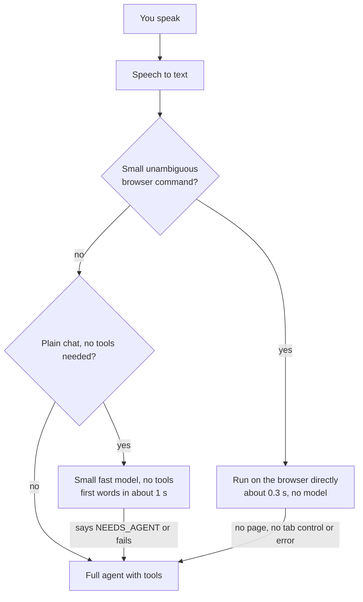

- **Instant path** (`modes/instant.py`): whole-utterance patterns only ("scroll down", "go back", "pause", "new tab", "switch to my LinkedIn tab", "search YouTube for ..."). Any mismatch or error hands the request to the agent.
- **Quick chat**: only for requests classified as plain conversation, never for anything that mentions the browser, files or an action word. The small model may answer with a single hand-off word; nothing has been spoken yet, so the agent then answers cleanly. What it said is recorded for the agent and for memory.
- **Every turn is timed.** One log line per turn, and a waterfall in Phoenix (speech to text, routing, agent start, model first token, every tool call, first sound). Each conversation has a **session id** that is its start time in epoch seconds, so all of its traces group under one session in Phoenix and map to a clock time.

## Failure modes: designing against brittleness

Every optimisation has a slower, safer path behind it, and a switch to turn it off.

| If this fails or is missing | What happens | Switch |
|---|---|---|
| Instant command doesn't match, no page open, tab control missing, any error | The agent handles the request | `agent.instant_browser` |
| Quick-chat model unavailable or says it needs tools | The agent answers | `agent.fast_chat` |
| Agent gives no sign of life for 40 s | Its thread is dropped and the request retried once on a clean one | `agent.first_response_timeout_s` |
| A one-step request keeps calling tools | It is stopped (6 calls; 40 for longer jobs) | `agent.single_step_tool_cap` |
| An element click fails | Retried on a freshly read page, then the real mouse is suggested | |
| Default microphone changes or goes stale | The stream is reopened, the audio system refreshed, a device that refuses 16 kHz is converted | |
| The app restarts | A clean agent thread plus a compact recap, never the full old thread | `agent.resume_after_restart` |
| Tracing, timing or telemetry fails | Swallowed: a turn never fails because of observability | `telemetry.enabled` |
| Chrome DevTools connection unavailable | Falls back to the AppleScript, then Playwright backends | `browser.backend` |
| Speech-to-text API unreachable or out of credit | Switch to the local engine with one setting | `stt.backend` |
| Memory extraction (Anthropic) unavailable | Skipped and retried next hour | |

Standing rule for changes to this project: check the architecture each time and keep it from becoming brittle. Before shipping, ask what happens if a dependency is missing, whether there is a safe fallback and an off switch, and whether the failure path has a test.

## Observability

OpenTelemetry spans around each mode and turn go to a local Phoenix instance (`uv tool run ... phoenix serve`). Per-turn latency (speech end → text → first audio) and cost are logged and shown.

## Extending

| To add | Do this |
|---|---|
| A mode | New file in `modes/` with `@modes.register("name")` |
| A quick action | New file in `actions/` with `@actions.register(...)` |
| A skill | New folder in `.claude/skills/<name>/SKILL.md` |
| A browser backend | Implement the backend protocol and register it |
| An STT engine | Implement the base class, register by name, select in `config.yaml` |
| A TTS voice service | Implement `Engine` in `tts/engines.py` and return it from `engine_for` |
| Another model provider | Implement `LLM` (`text`, `tool_calls`, `stream`) and `llm.set_llm(...)` |
| Another operating system | Implement `Platform` and `platform.set_platform(...)` |
| A front-end command or event | Add it to `api/protocol.py` / `api/events.py` (and `Protocol.swift`); tests fail until both sides agree |
| A new input kind | Add a channel in `channels/` that hands text to the core; add its view next to `VoiceInputView` |
| Agent tools | Add an in-process MCP tool and list it in the allowed tools |

## Known limits and next steps

- Learned lessons are text hints, not verified procedures; a lesson that stops working is only demoted by disuse (or by being told to forget it).
- Chrome requires one *Allow* click per app launch for the DevTools connection (a Chrome design choice).
- On open speakers, hearing itself is mitigated, not eliminated; headphones are the clean setup.
- Screenshot-based clicking depends on the model's aim; the ring marker and DOM-first strategy reduce, not remove, misses.
