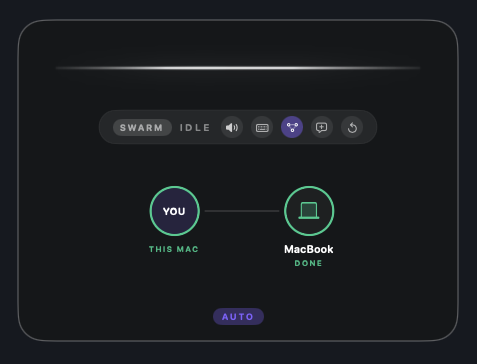
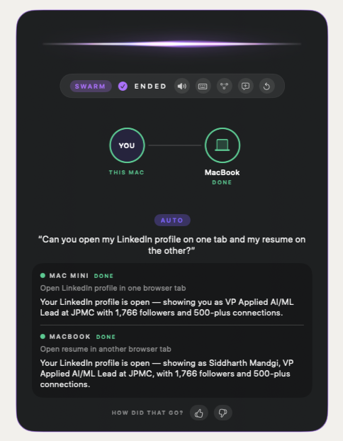
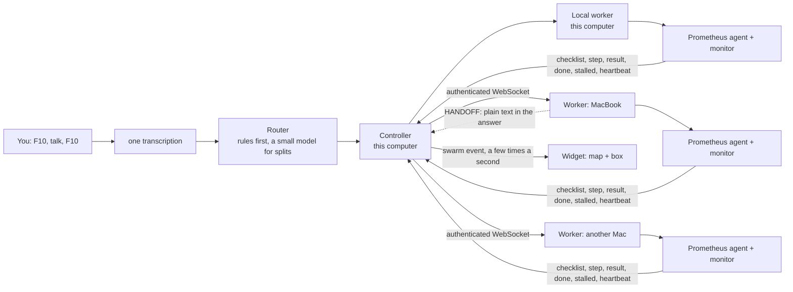

# Prometheus Swarm: one voice request, several of your Macs

**Prometheus Swarm** sends what you say to the right computer, or to several at once, and shows each one's progress on one card. You press **F10**, talk, press **F10** again. The computer you speak on understands you once, hands each part to the right worker, and each worker runs the normal Prometheus agent on its own screen, in its own already-logged-in Chrome, and reports back.

> This branch is only the swarm. The single-computer voice assistant it is built on (push-to-talk, the browser agent, dictation, memory, install and permissions) is described on the default branch: **[Voice Control, the single-mode README](https://github.com/siddh30/prometheus-voice-control)**. Read that first for the basics; everything below is what the swarm adds.
>
> A personal project, built in the open. macOS only. It drives real browsers on every computer you add and uses paid APIs, so read [Privacy and safety](#privacy-and-safety) first.

<table align="center">
  <tr>
    <td align="center" valign="middle"></td>
    <td align="center" valign="middle"></td>
  </tr>
  <tr>
    <td align="center"><sub><b>The map</b>: you in the middle, each computer's state around you</sub></td>
    <td align="center"><sub><b>One request, two computers</b>, each with its own result; thumbs rate the run</sub></td>
  </tr>
</table>

## What the swarm adds

- **Say where, or don't.** "Open Gmail on the MacBook", "check my calendar on both", "play it on the other computer", "close all tabs on this Mac". With no hint, a single job runs on the computer you are speaking on. Tap a computer on the map to send everything there; tap AUTO to let it decide.
- **Several jobs are spread out.** "Play lofi on YouTube and open Gmail": a small model splits independent jobs across your computers. Jobs that depend on each other stay together. If the model is slow or unavailable, everything runs on this computer.
- **"Both, but different"** ("test on both Macs, different results: first A, the other B") is split, one job each. The same job is never given to two computers unless you say "both".
- **A computer can pass work on mid-task.** A worker that needs another computer says so in plain words at the end of its answer. The controller sends the job on, with what it found, and the cards show "handed over by" and "passed on to". It is plain text, not a tool, it stops after three hops, and it cuts loops.
- **A silent computer is reported, not hidden.** A task that goes quiet shows as stalled; a computer that stops answering shows as not responding or offline, while the animation keeps running from its own clock.
- **It finds a computer again if its address changes.** The controller asks the network (a UDP broadcast that only workers with your token answer), so a router handing out a new address does not break the link.
- **You teach it.** Thumbs up or down after a run (with a note on what went wrong). Similar requests later are told what you liked and what you didn't, on every computer, and the router uses it too. `scripts/learnings.py` shows, adds and tests what it has learned.

## How it works



Your words are transcribed once. The controller never reaches into a worker with tools: it sends plain text to the worker's own agent and gets ticks back. Each worker runs the same agent as single mode, headless, with a monitor that reports "stalled" and "resumed". Full design, the message tables and every diagram: **[DESIGN.md](DESIGN.md)**.

## Set it up

You need the single-mode basics on the computer you speak on (Xcode command line tools, `uv`, Chrome with remote debugging, an Anthropic key, see the [single-mode README](https://github.com/siddh30/prometheus-voice-control)), then:

1. **The same secret on every computer:** put `SWARM_TOKEN=<a long random secret>` in `.env` on each. Never commit `.env`.
2. **The app, on the computer you speak on:**
   ```sh
   git clone -b swarm https://github.com/siddh30/prometheus-voice-control.git
   cd prometheus-voice-control
   APP_NAME="Prometheus Swarm" PROFILE_NAME=swarm scripts/release.sh "first install"
   open "$HOME/Applications/Prometheus Swarm.app"
   ```
   It is a separate app from Voice Control (its own name, icon, data folder and port), and grants its own permissions.
3. **List your other computers** in `~/Library/Application Support/PrometheusSwarm/config.local.yaml` (this file survives releases and is never committed):
   ```yaml
   swarm:
     name: Studio                       # this computer: "on the studio"
     aliases: [mini, desktop]
     pcs:
       - {name: MacBook, host: macbook-air, port: 8781, aliases: [laptop, air]}
   ```
   Give `host` as the computer's name, not a numeric address, so it can be found again if the address changes.
4. **On each other computer**, clone the same branch, put `SWARM_WORKER_NAME=<the host you listed for it>` in its `.env` (a fixed name, because macOS can change a hostname), and run:
   ```sh
   scripts/swarm_worker.sh install     # background worker, starts at login (also: status, uninstall)
   ```
   It has no window. After a restart it comes back by itself once you log in (turn on automatic login if the Mac should be ready without you).

The map shows each computer as online, working, quiet, not responding or offline. If a computer won't connect, `scripts/swarm_worker.sh status` on it says whether the worker is running, and its log says why.

### Updating

Release again on the main computer, and on each worker run `git pull` and `scripts/swarm_worker.sh install` so it runs the new code.

## The card

Buttons on the widget: voice on/off, type, the computers map, new conversation, **refresh** (clears the screen and reconnects, nothing is forgotten), **lightbulb** (forget what it learned) and **trash** (clear all memory). The two clearing buttons take two clicks. A card taller than its window scrolls. After a run, thumbs up or down.

## Switching between Voice Control and Prometheus Swarm

The two apps both use F9 and F10, so only one can run at a time. **Prometheus Switch** is a small app that swaps them: while it runs (its icon is in the menu bar), press **F12** anywhere. It quits the running app, waits until it has really exited, and opens the other. Click the icon for a card with both apps and a Switch button. It never force-quits an app. Install it once with `scripts/build_switcher.sh`; macOS asks for Accessibility and Input Monitoring the first time (needed to see F12 everywhere).

## Configuration

Swarm settings live under `swarm:` in `config.yaml` and `config.swarm.yaml`: `enabled`, `stall_after_s`, `silent_after_s`, `router_model`, `discovery` and `discovery_port` (8782), and `worker.host` / `worker.port` (8781). Per-computer settings (the other computers, this computer's name and aliases) go in `config.local.yaml`. Everything else is as in single mode.

## Privacy and safety

- **The shared token is the lock.** A worker refuses every connection that does not present `SWARM_TOKEN` (compared in constant time), and it will not start without one. Discovery answers only a request that proves it knows the token. The link is not encrypted: use it on a network you trust (your home network), not on public Wi-Fi.
- **Workers listen on your local network** (port 8781) only if you install them that way, and the discovery port is 8782.
- **Every computer acts for you.** Each worker drives its own real browser and keyboard with the same rules as single mode: it asks before anything that spends money, sends something or deletes, and you can approve or deny from the Mac you speak on.
- **Data stays local.** Memory, learnings, ratings and logs live in `~/Library/Application Support/PrometheusSwarm/` on each computer and are git-ignored. Your speech and text go to the providers you configure, as in single mode.
- Use at your own risk; this is a personal project and not a security-audited product.

## Known limits

- Each computer keeps its own conversation and learnings; the controller passes recent exchanges and your ratings along, but a worker does not see another worker's whole history.
- Delegation uses a model for splits, so it will sometimes choose differently than you would: say the computer to be exact.
- A task running on a computer that shuts off is lost, not resumed.
- macOS only.

## Troubleshooting

- **A computer stays offline:** is the worker installed and running there (`scripts/swarm_worker.sh status`), logged in, and on the same network? Is `SWARM_TOKEN` identical on both? Does `host` match the name that computer's `SWARM_WORKER_NAME` announces?
- **"Refused the shared token":** the two `.env` files have different `SWARM_TOKEN` values.
- **The card is stuck or odd:** the refresh button clears it and reconnects.
- Everything else (microphone, permissions, hotkeys) is the same as in the [single-mode README](https://github.com/siddh30/prometheus-voice-control).

## License

No license has been chosen yet; until one is added, all rights are reserved. Open an issue if you'd like to use it.
