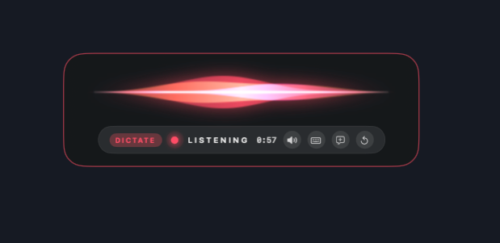
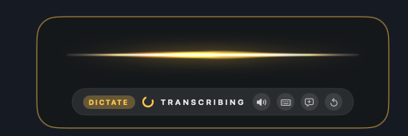
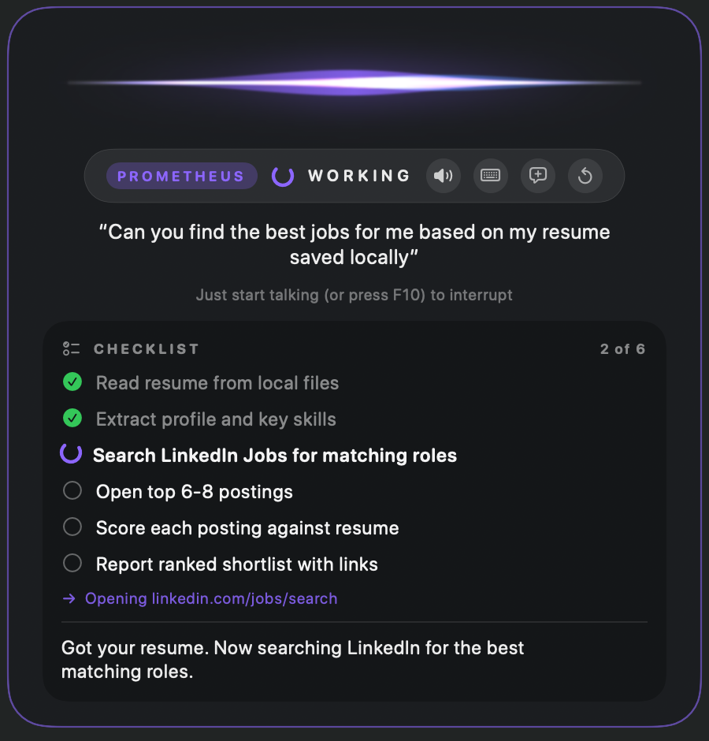
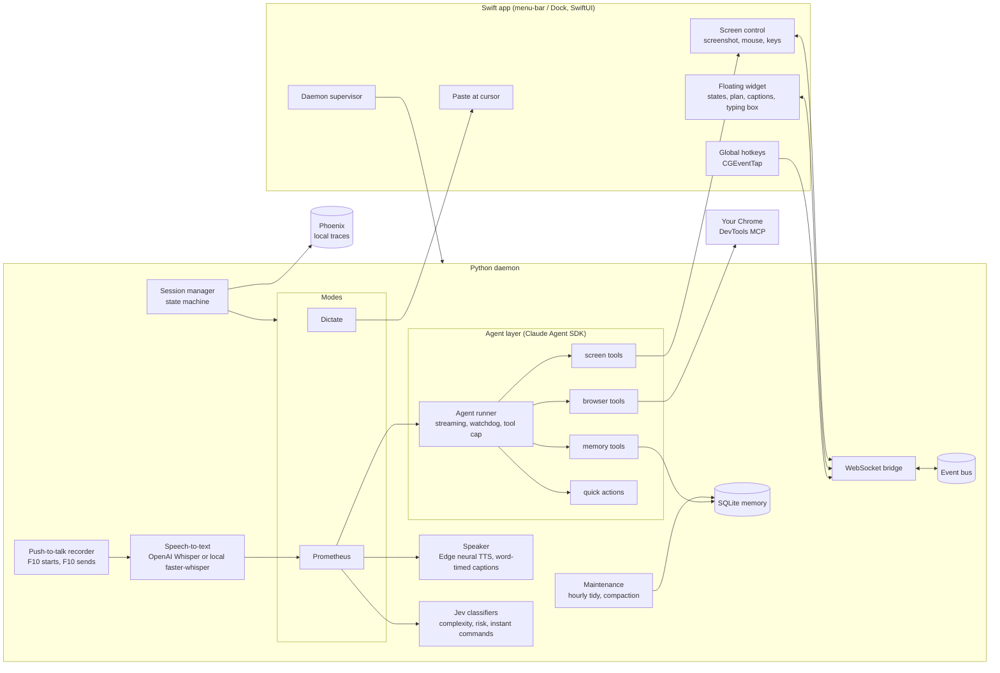
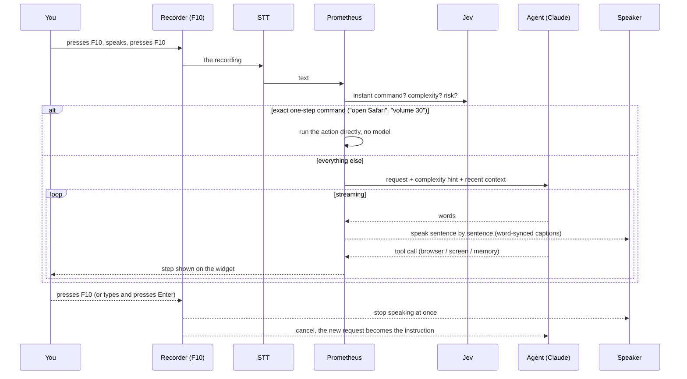

# Prometheus: a voice assistant for macOS that talks *and* acts

Press **F10**, talk, and press **F10** again. It answers out loud, and it can also *do* things: search YouTube and play a song, switch to a tab, scroll a page, fill a form, click what it sees on screen, read a file. It runs in **your own, already-logged-in Chrome**, narrates what it is doing, shows a plan for bigger jobs, and you can interrupt it any time by pressing F10 or typing. Nothing listens in between: the microphone is open only while you record.

It also remembers. It keeps what it knows about you, and it learns from what worked and what failed on the sites it visits, so it takes fewer steps next time.

> A personal project, built in the open. macOS only (developed on Apple Silicon). It uses paid APIs and drives your real browser and mouse, so read [Privacy and safety](#privacy-and-safety) before using it.

## What you get

| | |
|---|---|
| **Prometheus** (**F10**: press to record, press again to send) | A push-to-talk conversation with one Claude agent that also acts: your own Chrome, the screen and mouse, files, the web. |
| **Dictate** (**F9**) | Press, talk, press again: your words are typed at the cursor in any app. |
| **A floating widget** | Siri-style ribbons and a state label (listening, thinking, working, speaking), the plan and steps, live captions. Buttons: voice on/off, type to Prometheus, new conversation, start fresh. |

## Screenshots

### Dictate mode (F9)

<table align="center">
  <tr>
    <td align="center" valign="middle"></td>
    <td align="center" valign="middle"></td>
  </tr>
  <tr>
    <td align="center"><sub><b>1. Listening</b></sub></td>
    <td align="center"><sub><b>2. Transcribing</b>, then the text is typed at your cursor</sub></td>
  </tr>
</table>

### Prometheus mode (F10 or "Prometheus")

<p align="center"></p>
<p align="center"><sub><b>Working</b> through a multi-step job, with the plan and the current step on screen.</sub></p>

Things it does well:

- **Interrupt it.** Press F10 (or type and press Enter) while it speaks or works: it stops and follows your newest request. The microphone is closed whenever you are not recording, so there is nothing to talk over and no wake word.
- **Right amount of ceremony.** A question gets a one-line answer; a one-step action gets one sentence; a multi-step job gets a checklist.
- **No permission nagging.** Ordinary things (open, search, click, play) just happen. Only money, sending and deleting are gated.
- **Operates the browser like a person**: switches tabs, uses shortcuts, goes straight to the right URL, and falls back to the real mouse when a page element can't be clicked.
- **Learns.** It records which actions work or fail per site and turns that into lessons it applies to the right task later.

## How it works

A Swift app owns the widget, global hotkeys and the macOS permissions (screen, mouse, keyboard). A Python daemon owns audio, speech models and the agent. They talk over a local WebSocket. The agent is Claude (via the Claude Agent SDK) with tools for the browser (Chrome DevTools MCP), the screen, memory and quick actions.

### Architecture



### One conversational turn



Full design, memory model, safety and the extension points: **[DESIGN.md](DESIGN.md)**.

## Requirements

- macOS on Apple Silicon (developed and tested on a recent macOS; Intel is untested)
- [uv](https://docs.astral.sh/uv/) (it installs Python 3.14 for you), Xcode Command Line Tools (`xcode-select --install`, for Swift)
- **Google Chrome**, and [Node.js](https://nodejs.org) for browser control (`brew install node`)
- API keys:
  - **Anthropic** (required): powers the agent.
  - **OpenAI** (default speech-to-text, Whisper): or run fully local speech-to-text with `stt.backend: faster_whisper` and no key.
  - TypeSafe, Tavily, OpenWeatherMap (all optional, see `.env.example`).

Expect real API spend: a long browsing session can cost on the order of a dollar. Keep an eye on your Anthropic usage.

## Install

```sh
# 0. Tools (one time; skip any you already have)
xcode-select --install                                   # Swift, git
/bin/bash -c "$(curl -fsSL https://raw.githubusercontent.com/Homebrew/install/HEAD/install.sh)"   # Homebrew
brew install uv                                          # or: curl -LsSf https://astral.sh/uv/install.sh | sh

git clone https://github.com/siddh30/prometheus-voice-control.git
cd prometheus-voice-control

# 1. Keys (never commit .env; it is git-ignored)
cp .env.example .env        # then fill in at least ANTHROPIC_API_KEY (and OPENAI_API_KEY)

# 2. Browser control (one time)
brew install node
npm install -g chrome-devtools-mcp

# 3. Build and install the app into ~/Applications
scripts/release.sh "first install"
open "$HOME/Applications/Voice Control.app"
```

Then:

1. **Grant permissions** in System Settings > Privacy & Security to *Voice Control*: **Microphone**, **Accessibility**, **Input Monitoring**, **Screen Recording** (screen looking only).
2. **Turn on Chrome remote debugging:** in Chrome open `chrome://inspect/#remote-debugging` and enable it. The first time Prometheus drives the browser, Chrome shows an *Allow* prompt, once per app launch. Chrome will also show a "controlled by automated test software" banner while it works.
3. Say **"Prometheus"**, or press **F10**.

**Dock or Desktop:** the app is installed at `~/Applications/Voice Control.app`. Drag it from Finder to the Dock to pin it, or hold **Option+Command** while dragging it to the Desktop to make a shortcut. Tip: wearing headphones gives the best experience (no echo, so you can interrupt freely).

## Using it

| You say / do | What happens |
|---|---|
| "Play Daft Punk on YouTube" | Opens the search in a tab, picks the real result, plays it. The song keeps playing; press F10 to talk over it. |
| "Switch to my LinkedIn tab and scroll down" | Uses the tab and scroll tools, and reports if the page didn't move. |
| "Open it in another tab" | Does exactly that and stops. |
| Press F10, or click the keyboard button and type | Interrupts and follows your newest instruction. |
| "Thanks, that's all" / "bye" | Ends the conversation with a friendly goodbye. |
| "New conversation" or "you're stuck" | Clean context, keeps what it knows about you. |
| "Start fresh" / "forget everything" | Wipes conversations and facts (it keeps what it learned about *how* to do things). |
| "Forget what you've learned" | Erases the learned lessons. |
| "What have you learned?" | Lists them. |
| "Text only" / "speak to me" | Switches between spoken and silent replies (handy on speakers). |

## Configuration

Everything is in `config.yaml` (hotkeys, models, voice, speed, pause length, memory limits, browser backend). Common tweaks:

```yaml
tts:
  voice: en-US-ChristopherNeural   # any Edge neural voice: en-US-AndrewNeural, en-GB-RyanNeural, ...
  rate: "+25%"
conversation:
  silence_s: 1.4                   # how long a pause means "I'm done talking"
stt:
  backend: openai                  # or faster_whisper for fully local, offline transcription
```

## Privacy and safety

- **What leaves your Mac:** your speech and text go to the speech, language-model and voice providers you configure, and agent traffic goes to Anthropic. **Nothing listens in the background**: the microphone is open only while you record, and there is no wake word.
- **Your data stays local:** memory, learnings, the voice cache, traces and logs live in `~/Library/Application Support/VoiceControl/` and are git-ignored. Keys live in `.env`.
- **It controls your real browser, mouse and keyboard.** It asks before anything that spends money, sends something or deletes. Page content is treated as data, not instructions, but no prompt-injection defence is perfect: do not point it at untrusted pages while logged in to sensitive accounts.
- Use at your own risk; this is a personal project and not a security-audited product.

## Two versions: stable and dev

The installed **Voice Control** app runs from a frozen snapshot, so editing the code never changes it under you. To work on the code safely:

```sh
scripts/dev.sh test      # run the test suite (also: pytest)
scripts/dev.sh run       # run the daemon with its own data, port, no hotkeys/mic/voice
scripts/release.sh "what changed"   # freeze the current code as the version you use (quit the app first)
```

## Extending

- A quick action: a file in `src/voicectl/actions/` with `@actions.register(...)`
- A skill: `.claude/skills/<name>/SKILL.md`
- A mode, STT/TTS engine or browser backend: register it by name and select it in `config.yaml`

Details and the extension table are in [DESIGN.md](DESIGN.md).

## Known limits

- Chrome asks for one *Allow* per app launch (its design, not ours).
- Screenshot clicking depends on the model's aim; the agent prefers page elements and URLs and uses the mouse as a fallback.
- Open speakers can still leak its voice back into the mic; headphones are the clean setup.
- Learned lessons are text hints, not verified procedures.
- macOS only.

## Troubleshooting

- **It doesn't hear me:** check the Microphone permission and your default input device. It re-opens the mic automatically if the device changes.
- **"Credit balance is too low":** your Anthropic account is out of credit.
- **Hotkeys do nothing:** grant Accessibility and Input Monitoring, then reopen the app.
- **Permissions reset after every update:** without a signing certificate the app is signed ad hoc, and macOS treats each build as a new app. Create a code-signing certificate named `Voice Control Local Signing` in Keychain Access (Certificate Assistant > Create a Certificate, type *Code Signing*) and future builds keep their permissions.
- **Updating:** `git pull`, quit the app, then `scripts/release.sh "update"` and reopen it.
- **Stuck on "thinking":** click the new-conversation button, or say "new conversation". The previous run's log is `daemon.log.prev` in the data folder.

## License

No license has been chosen yet; until one is added, all rights are reserved. Open an issue if you'd like to use it.
