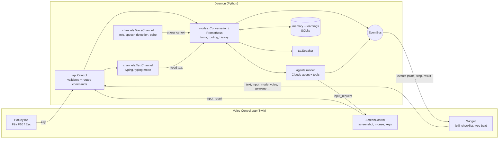
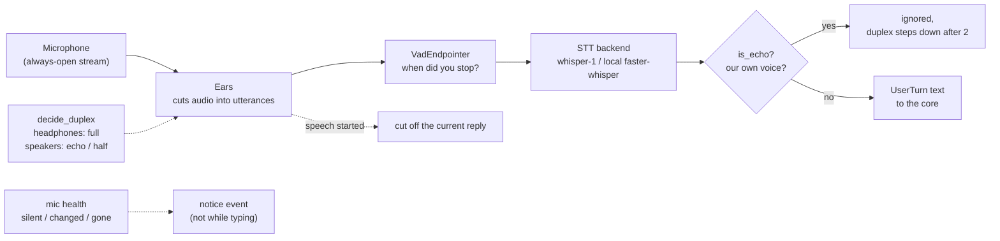
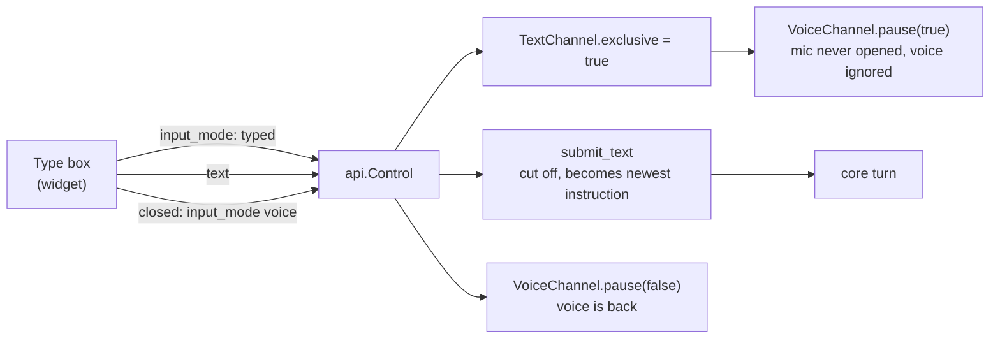
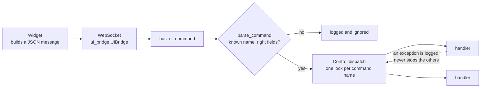
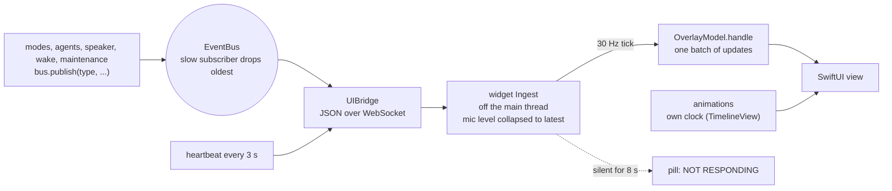
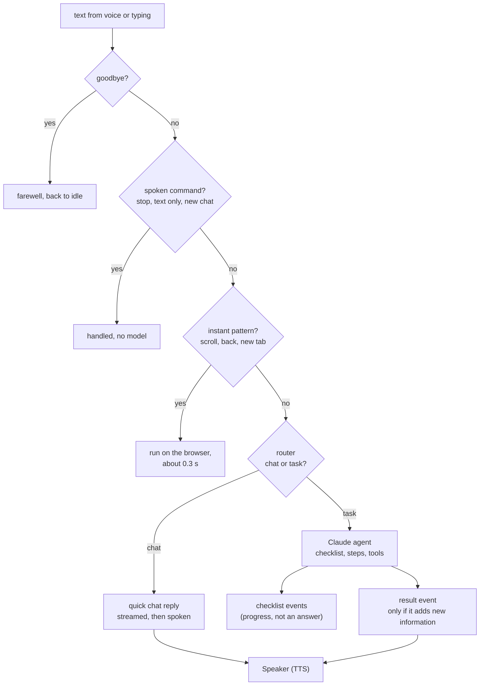
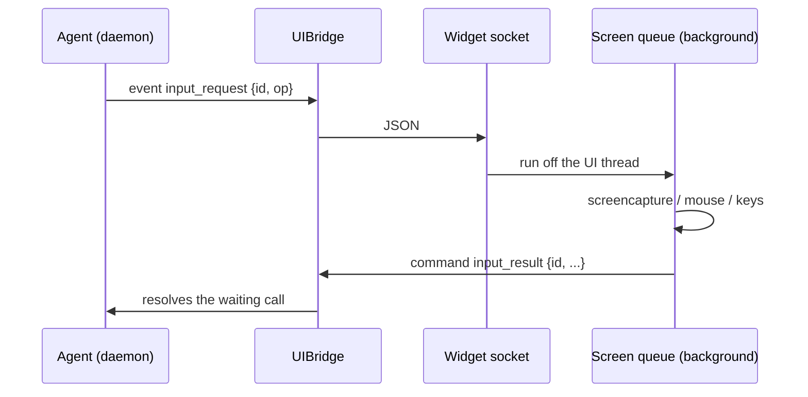
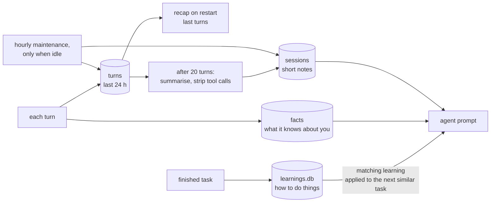

# Architecture: the main app and every API pathway

The app is a **widget** (Swift) and a **daemon** (Python) that only talk through two small, typed contracts. Inside the
daemon, the two ways a request arrives (voice, typing) are separate channels that feed one core. Every diagram below
is one pathway; the code that owns it is named under it.

## 1. The main app

Owns it: `src/voicectl/main.py` wires everything; `overlay/Sources/VoiceOverlay/` is the app.

## 2. The voice path

Owns it: `channels/voice.py`, `core/ears.py`, `core/vad.py`, `core/echo.py`, `stt/`.

## 3. The typing path

While the box is open the widget hides the waveform, the listening timer, the voice toggle and the hints
(`OverlayModel.usesMic`). Owns it: `channels/text.py`, `main.py` (`input_mode`, `text` handlers).

## 4. The command path (widget to daemon)

Commands: `text`, `input_mode`, `voice`, `wake`, `newchat`, `fresh`, `maintenance`, `key`, `approval`,
`input_result`. The table is `api/protocol.py`; a slow command never holds up a different one, and the same command
keeps its order. Owns it: `api/`, `ui_bridge/server.py`.

## 5. The event path (daemon to widget)

The widget's animation never waits on the daemon: the daemon only changes what is shown. The event table is
`api/events.py`; the test suite checks every event ever published against it. Owns it: `api/events.py`,
`ui_bridge/server.py`, `Socket.swift`, `Model.swift`.

## 6. How a request is answered

Owns it: `modes/prometheus.py`, `modes/instant.py`, `modes/router.py`, `agents/runner.py`.

## 7. The screen and mouse path

Screenshots, clicks and key presses never run on the widget's main thread. Owns it: `agents/screen.py`,
`ScreenControl.swift`, `Socket.swift`.

## 8. The memory path

Owns it: `core/memory.py`, `core/learnings.py`, `core/maintenance.py`.

## Rules the code follows

- The widget and the daemon share only `api/protocol.py` (commands) and `api/events.py` (events). Tests fail if
  either side uses something that isn't in them.
- Voice and typing are separate channels. Nothing in the core asks which one a request came from.
- The widget's animation runs on its own clock. Backend messages are buffered off the main thread and applied in
  batches; if the daemon goes quiet the widget says so and keeps animating.
- Anything slow (screenshots, clicks, network) runs off the UI thread.
